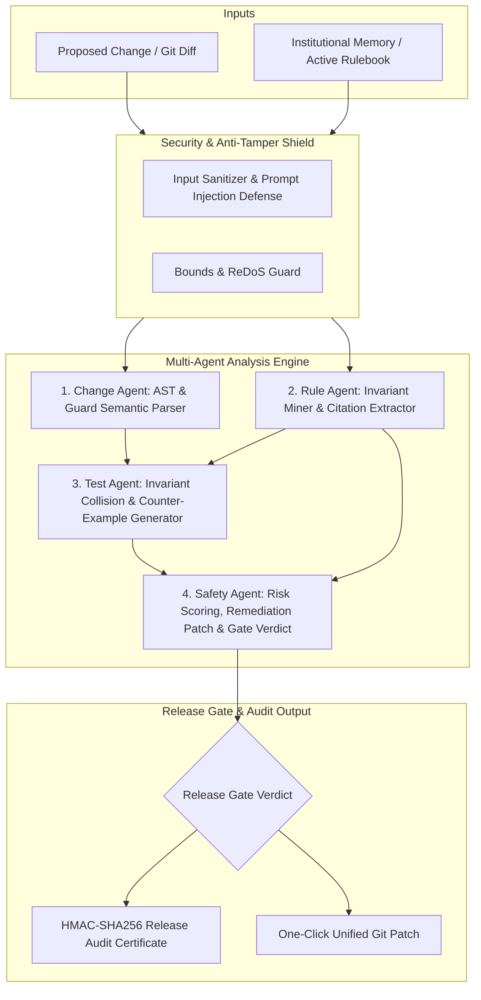

# RuleGuard Enterprise 2.0

> **Pre-Release Software Safety Governance & Institutional Memory Gatekeeper**
>
> Automated multi-agent invariant verification platform that bridges historical incident memory, architectural decision records (ADRs), and compliance guardrails with active code changes before deployment.

[](https://www.typescriptlang.org/)
[](LICENSE)
[](#security-architecture)
[](#compliance--audit-readiness)

---

## 🎯 Executive Overview & Business Value

In modern fast-paced software organizations, critical domain rules, compliance mandates, and hard-won lessons from production outages are frequently scattered across closed Jira issues, post-mortem incident reports (RCAs), Slack threads, and tribal knowledge. 

When engineers refactor or optimize code, conventional unit and integration test suites only test the assertions developers explicitly remember to write. Tests pass with a false sense of security—leading to silent regressions in business invariants (e.g., bypass of dual-authorization thresholds, race conditions in order processing, HIPAA audit omissions, or telemetry retention leaks).

**RuleGuard Enterprise** operates as an intelligent safety gate between your source code changes (`git diff`) and your release pipelines. It continuously evaluates proposed changes against active business invariants and historical corporate knowledge, detecting regressions with automated patch generation and tamper-evident cryptographic sign-off.

---

## 🏛️ System Architecture

RuleGuard employs a multi-stage cognitive pipeline designed for zero-trust release analysis:



### Cognitive Agents

1. **Change Agent ([`backend/src/agents/changeAgent.ts`](backend/src/agents/changeAgent.ts))**:
   - Parses unified Git diffs (`--- a/... +++ b/...`) and source files.
   - Detects removed preconditions, loosened conditional checks, altered thresholds, affected domain entities, and blast radius.
2. **Rule Agent ([`backend/src/agents/ruleAgent.ts`](backend/src/agents/ruleAgent.ts))**:
   - Discovers latent business rules from raw organizational records (post-mortems, compliance guides, tickets).
   - Maps against the company's active invariant rulebook with exact verbatim citations and statistical confidence ratings.
3. **Test Agent ([`backend/src/agents/testAgent.ts`](backend/src/agents/testAgent.ts))**:
   - Executes deterministic collision analysis between the parsed code modification and the mined invariants.
   - Generates counter-example failure scenarios showing the operational exploit or compliance breach.
4. **Safety Agent ([`backend/src/agents/safetyAgent.ts`](backend/src/agents/safetyAgent.ts))**:
   - Computes weighted numerical risk scores (0–100) and severity ratings (`CRITICAL`, `HIGH`, `MEDIUM`, `LOW`).
   - Issues the binding release gate verdict (`Safe to release`, `Release blocked`, or `Review required`).
   - Synthesizes a unified `.patch` that restores the invariant while retaining intended developer optimizations.

---

## 🔒 Security Architecture

RuleGuard is engineered with enterprise defense-in-depth principles:

* **Cryptographic Tamper-Evident Certificates**: Every audit generates a SHA-256 fingerprint signed with a server-side HMAC-SHA256 key, verifiable via `POST /api/verify-certificate`.
* **Adversarial Injection & Bypass Defense**: The security shield scans input payloads for prompt injection or system override attempts before invoking inference layers.
* **Bounded Compute & ReDoS Protection**: Enforces strict payload caps (500KB per input field) and regex boundary limits to prevent resource exhaustion attacks.
* **Strict Transport Security & Headers**: Hardened with Helmet HTTP headers (strict CSP, HSTS, X-Content-Type-Options: nosniff, Frameguard: DENY).
* **Network Rate Limiting**: Tiered IP rate limiting (200 requests/15m general; 60 requests/1m for compute-intensive analysis).
* **Zero-Config Offline Capability**: Functions entirely air-gapped without external network calls via the built-in deterministic AST semantic heuristic engine.

---

## 🏢 Pre-Loaded Industry Scenarios

RuleGuard comes out of the box with realistic enterprise case studies:

| Sector | Scenario | Invariant Protected | Unsafe Risk |
| :--- | :--- | :--- | :--- |
| **Fintech** | Payment Processing | Dual-manager sign-off required for refunds > ₹5,000 | Unauthorized fund drainage |
| **Cybersecurity** | IAM & Authentication | 5 failed attempts triggers progressive lockout | Credential stuffing vulnerability |
| **Healthcare** | HIPAA Records Portal | All PHI patient export calls must generate immutable audit logs | Federal compliance breach |
| **Data Privacy** | GDPR Compliance | User deletion cascade must purge peripheral telemetry records | Regulatory GDPR Article 17 fines |
| **E-Commerce** | Flash Sale Engine | Inventory decrement must acquire an atomic distributed lock | Negative stock / overselling collision |

---

## 🚀 Getting Started

### Prerequisites

- Node.js 18+ (Node 20+ recommended)
- npm 9+
- Docker & Docker Compose (optional, for containerized deployment)

### 1. Installation

```bash
# Clone the repository
git clone https://github.com/SrinivasaKamathB/RuleGuard.git
cd RuleGuard

# Install backend dependencies
cd backend
npm install

# Install frontend dependencies
cd ../frontend
npm install
```

### 2. Environment Configuration

Copy the example environment configuration:

```bash
cp .env.example .env
```

Key environment variables:
- `PORT`: Backend server port (default: `3001`).
- `ALLOWED_ORIGINS`: Permitted frontend origins for CORS (default: `http://localhost:5173`).
- `RELEASE_SIGNING_SECRET`: High-entropy key used for HMAC-SHA256 certificate generation.
- `GEMINI_API_KEY` / `OPENAI_API_KEY`: *(Optional)* API keys for cloud model providers. If omitted, RuleGuard seamlessly operates using its offline deterministic AST engine.

### 3. Local Development

```bash
# Terminal 1: Launch Backend Engine (Port 3001)
cd backend
npm run dev

# Terminal 2: Launch Frontend Intelligence Deck (Port 5173)
cd frontend
npm run dev
```

Open `http://localhost:5173` in your browser.

---

## 🛠️ CLI & CI/CD Pipeline Integration

RuleGuard can be run directly inside CI/CD workflows to automatically gate pull requests.

### CLI Usage

```bash
# Scan a unified Git diff file
cd backend
npm run cli -- --diff ../pr_changes.diff --env production

# Pipe live git diff into the CLI
git diff origin/main...HEAD | npx tsx src/cli.ts
```

### CLI Exit Codes
- `0`: Invariant checks passed — **Safe to release**.
- `1`: Invariant violation detected — **Release blocked**.
- `2`: Review required or input bounds anomaly — **Manual signoff required**.

### GitHub Actions Workflow

A ready-to-use GitHub Actions workflow is provided at [`.github/workflows/ruleguard-ci.yml`](.github/workflows/ruleguard-ci.yml):

```yaml
name: RuleGuard Release Safety Gate

on:
  pull_request:
    branches: [ main, master ]

jobs:
  ruleguard-audit:
    runs-on: ubuntu-latest
    steps:
      - uses: actions/checkout@v4
        with:
          fetch-depth: 0
      - uses: actions/setup-node@v4
        with:
          node-version: 20
      - run: |
          cd backend && npm ci
          git diff origin/${{ github.base_ref }}...HEAD > pr_changes.diff
          npm run cli -- --diff ../pr_changes.diff --env production
```

---

## 🐳 Docker Container Deployment

Deploy RuleGuard as a production container stack:

```bash
# Build and run backend and frontend containers
docker compose up --build -d

# Check service logs
docker compose logs -f
```

The services will be exposed at:
- Frontend: `http://localhost:80`
- Backend API: `http://localhost:3001`

---

## 🧪 Automated Test Suite

RuleGuard includes comprehensive test coverage verifying diff parsing, prompt sanitization, HMAC integrity, and multi-domain collision detection.

```bash
cd backend
npm test
```

Executes all 14 unit and integration test suites:
- Regression detection on loosened conditionals
- Preservation of safety invariants on optimized code
- Rate limiter & prompt injection resistance
- Healthcare PHI and E-commerce mutex lock validations

---

## 📋 Compliance & Audit Readiness

RuleGuard release audit certificates provide documentary evidence for:

- **SOC 2 Type II (Trust Services Criteria)**: Verification of change management controls (CC8.1) and authorization boundaries.
- **ISO/IEC 25010 Systems and Software Quality**: Functional suitability, reliability, and security assessment.
- **Change Advisory Board (CAB) Sign-Offs**: Cryptographic proof of human-in-the-loop review and invariant verification attached to release tickets.

---

## 📄 License

RuleGuard is released under the [MIT License](LICENSE).